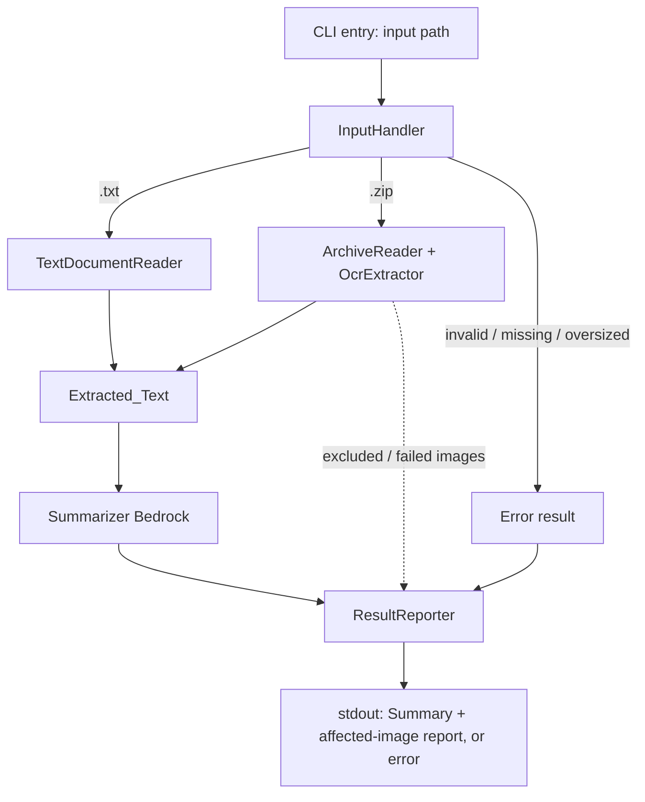

# Design Document

## Overview

The Text Summary Extractor is a proof-of-concept command-line application, written in TypeScript, that turns one input file into a concise summary. It accepts either a plain text document (`.txt`) or a ZIP archive (`.zip`) of images (`.png`, `.jpg`, `.jpeg`) that contain text.

The processing pipeline has three stages:

1. **Input handling** — classify the input, validate it exists and is readable, enforce the size limit, and (for archives) enumerate supported images. All rejections happen here, before any AWS call, so unsupported or oversized inputs never incur cost.
2. **Text extraction** — for a text document, read the file directly (no AWS). For an image archive, run each supported image through Amazon Textract OCR and concatenate the results in filename order.
3. **Summarization** — send the extracted text (truncated to a configurable ceiling) to Amazon Bedrock and return the generated summary.

The design deliberately favors a straightforward, linear flow over abstraction. Cost efficiency drives three concrete decisions that appear throughout: reject bad input before spending money, call Textract only for supported images (once each, with limited retry), and truncate the summarizer input.

Because this is a proof of concept, automated tests are out of scope and are not part of this design.

### AWS Services and SDK

- **Amazon Textract** via `@aws-sdk/client-textract`. We use the synchronous `DetectDocumentTextCommand`, which accepts a single image as bytes and returns text blocks. It fits per-image, in-memory processing without needing S3 or async job polling, which keeps the POC simple and cheap.
- **Amazon Bedrock** via `@aws-sdk/client-bedrock-runtime`. We use `InvokeModelCommand` (or `ConverseCommand`) against a text foundation model to produce the summary.

## Architecture



The flow is a single pass. `InputHandler` decides the branch and gates all AWS work. The two extraction branches converge on a single `Extracted_Text` string, which the `Summarizer` consumes. `ResultReporter` is the one place that writes to the user, combining the summary with any excluded/failed image report.

### Module layout

| Module | Responsibility |
| --- | --- |
| `cli.ts` | Parse the input path argument, load config, invoke the pipeline, exit with the reported result. |
| `config.ts` | Resolve `Max_Input_Size`, `Max_Summarizer_Input`, and summarizer timeout from defaults / environment. |
| `inputHandler.ts` | Classify input, check existence/readability, enforce size limit, enumerate archive images, record excluded entries. |
| `textReader.ts` | Read and decode a `.txt` document into `Extracted_Text`. |
| `ocrExtractor.ts` | Call Textract per image with retry, aggregate text, record per-image failures. |
| `summarizer.ts` | Truncate input, call Bedrock with timeout, return the summary. |
| `reporter.ts` | Render the final summary + affected-image report, or a single stage-tagged error. |
| `pipeline.ts` | Orchestrate the stages and thread the `ProcessingResult` through. |
| `types.ts` | Shared types (below). |

## Components and Interfaces

The pipeline threads a small set of result types rather than throwing across boundaries. Each stage returns either a success payload or a stage-tagged failure, which keeps the "report a single failed stage" requirement (6.3) easy to satisfy.

```typescript
type Stage = "input-handling" | "text-extraction" | "summarization";

interface StageError {
  stage: Stage;
  message: string;
}

// Result of classification + validation
type InputClassification =
  | { kind: "text"; path: string }
  | { kind: "archive"; path: string; images: ArchiveImage[]; excluded: ExcludedEntry[] };

interface ArchiveImage {
  name: string;      // entry name within the zip
  bytes: Uint8Array; // uncompressed image bytes
}

interface ExcludedEntry {
  name: string;
  reason: "unsupported-type";
}

// Per-image OCR outcome
interface ImageFailure {
  name: string;
  reason: string; // e.g. "OCR failed after retries"
}

// Text extraction result
interface ExtractionResult {
  text: string;
  imageFailures: ImageFailure[];   // OCR failures (archive only)
  excluded: ExcludedEntry[];       // carried from input handling
}

// Final pipeline result
type ProcessingResult =
  | {
      ok: true;
      summary: string;
      affectedImages: string[]; // names of excluded + OCR-failed images
    }
  | { ok: false; error: StageError };
```

### InputHandler

```typescript
function classifyAndValidate(
  path: string,
  config: Config
): Promise<Result<InputClassification, StageError>>;
```

Behavior:

- Extension is checked case-insensitively: `.txt` → text, `.zip` → archive, anything else → error naming the detected extension (1.1, 1.2).
- Missing path → "not found" error; existing-but-unreadable path → "could not be accessed" error (1.3, 1.4).
- For a text document, compare file byte size against `Max_Input_Size`; reject if strictly greater, stating the configured limit (2.2).
- For an archive, enumerate entries; those ending `.png`/`.jpg`/`.jpeg` (case-insensitive) become `ArchiveImage` entries (1.5), all others are recorded as `ExcludedEntry` without any OCR call (2.4). If there are zero supported images, return the "no supported images" error (1.6).
- Sum the uncompressed sizes of all archive entries; reject if strictly greater than `Max_Input_Size`, stating the limit (2.3).

All of the above runs before any Textract or Bedrock call, satisfying the cost-control ordering in 2.2 and 2.3.

### TextDocumentReader

```typescript
function readTextDocument(path: string): Result<string, StageError>;
```

Reads the file and decodes it as UTF-8. If decoding fails, returns a "could not be decoded" error (3.3). If the decoded content is empty or whitespace-only, returns a "document is empty" error (3.2). Otherwise returns the content as `Extracted_Text` with no OCR involvement (3.1).

### OcrExtractor

```typescript
function extractFromArchive(
  images: ArchiveImage[],
  excluded: ExcludedEntry[],
  textract: TextractClient
): Promise<Result<ExtractionResult, StageError>>;
```

Behavior:

- For each supported image, call `DetectDocumentTextCommand` exactly once, retrying up to 2 additional times **only** on transient errors (throttling / 5xx / network) (4.1). Excluded entries are never sent (4.5).
- On success, join the returned `LINE` blocks into that image's text.
- Images are processed and their text concatenated in ascending order of entry name (4.2).
- An image that still fails after retries is recorded in `imageFailures`; processing continues with the rest (4.3).
- If no image yields any non-whitespace text, return a "no text was extracted" error (4.4).

### Summarizer

```typescript
function summarize(
  text: string,
  config: Config,
  bedrock: BedrockRuntimeClient
): Promise<Result<string, StageError>>;
```

Behavior:

- If `text` is empty or whitespace-only, return a "no text to summarize" error without calling Bedrock (5.2). (The pipeline should not reach here in that state, but the guard keeps the invocation cost-safe.)
- If the UTF-8 byte length of `text` exceeds `Max_Summarizer_Input`, truncate to that byte length before invoking Bedrock (5.5).
- Invoke Bedrock with a summarization prompt, racing the call against the configured timeout. On error or timeout, return a "summarization failed" error and no summary (5.4). On success, return the summary text (5.1, 5.3).

### ResultReporter

```typescript
function report(result: ProcessingResult): void;
```

- On success, print the summary. If `affectedImages` is non-empty, also print the total count and each affected file name alongside the summary — the run is still a success (6.1, 6.2, 6.4).
- On failure, print a single descriptive message tagged with the failed stage and print no summary (6.3).

## Data Models

### Config

```typescript
interface Config {
  maxInputSizeBytes: number;       // default 10_485_760, valid 1..104_857_600
  maxSummarizerInputBytes: number; // truncation ceiling for summarizer input
  summarizerTimeoutMs: number;     // Bedrock invocation timeout
  bedrockModelId: string;          // foundation model used for summarization
  awsRegion: string;
}
```

- `maxInputSizeBytes` defaults to `10_485_760` (10 MB) and is clamped/validated to the inclusive range `1 .. 104_857_600` (100 MB) (2.1). Values outside the range fall back to the default.
- `maxSummarizerInputBytes` and `summarizerTimeoutMs` are configurable (5.5, 5.4) with sensible POC defaults.
- Configuration is resolved from environment variables with the defaults above; no config file is needed for the POC.

### Extracted_Text

A single `string`. For a text document it is the decoded file content. For an archive it is the concatenation of each supported image's detected text, ordered by entry name, separated by a newline.

### Affected-image reporting

`affectedImages` is the union of excluded entry names (unsupported types found in the archive) and OCR-failed image names, surfaced together in the final report (6.2).

## Error Handling

Errors are represented as values (`StageError`), not exceptions crossing stage boundaries, so the reporter can always name exactly one failed stage (6.3). Each stage returns a `Result`, and `pipeline.ts` short-circuits on the first failure.

| Condition | Stage | Requirement |
| --- | --- | --- |
| Unsupported extension | input-handling | 1.2 |
| Input path not found | input-handling | 1.3 |
| Input exists but unreadable | input-handling | 1.4 |
| Archive has no supported images | input-handling | 1.6 |
| Input exceeds `Max_Input_Size` | input-handling | 2.2, 2.3 |
| Text document empty / whitespace-only | text-extraction | 3.2 |
| Text document not decodable | text-extraction | 3.3 |
| No text extracted from any image | text-extraction | 4.4 |
| Summarizer error or timeout | summarization | 5.4 |
| No text to summarize | summarization | 5.2 |

Consistent with the POC scope and the "focus on the happy path" guidance, error handling covers exactly the conditions the requirements name and no more. Non-fatal conditions — individual image OCR failures and excluded entries — are collected and reported alongside a successful summary rather than aborting the run (4.3, 6.4).

### Textract retry policy

OCR retries are limited to transient errors and capped at 2 additional attempts per image (4.1). A permanent error (for example, an unreadable image) is not retried; it is recorded as an `ImageFailure` and the run continues.

## Testing Strategy

This is a proof of concept and automated testing is explicitly out of scope. No unit, integration, or property-based tests are defined for this feature. Validation is performed by manually running the CLI against a sample `.txt` file and a sample `.zip` of images and inspecting the printed summary and affected-image report.
