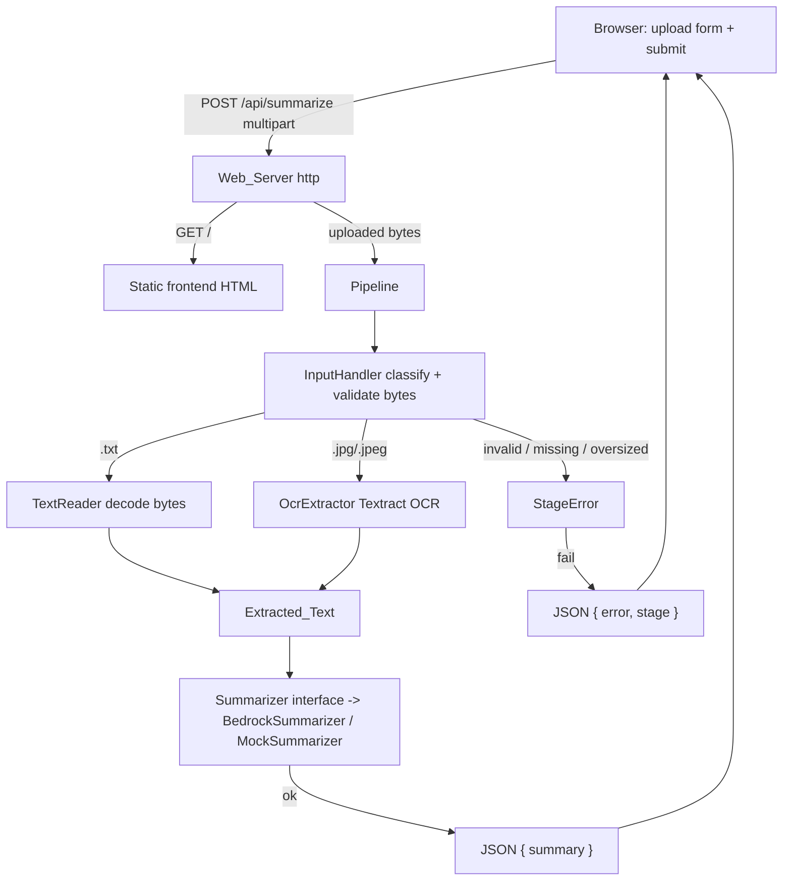

# Design Document

## Overview

The Text Summary Extractor is a proof-of-concept web application, written in TypeScript, that turns a single uploaded file into a concise summary. A user opens a browser page served by a local HTTP server, picks one file that is either a plain text document (`.txt`) or a single JPEG image (`.jpg`/`.jpeg`), submits it, and sees the resulting summary — or a descriptive error — displayed on the page.

The file arrives at the server as in-memory bytes (an upload, not a filesystem path), so every stage operates on bytes rather than paths. The processing pipeline has three stages:

1. **Input handling** — classify the uploaded file by extension, validate it is present and its bytes are readable, and enforce the size limit. All rejections happen here, before any AWS call, so unsupported or oversized inputs never incur cost.
2. **Text extraction** — for a text document, decode the bytes directly (no AWS). For a JPEG image, run the image bytes through Amazon Textract OCR (one call, with limited retry) to obtain the detected text.
3. **Summarization** — send the extracted text (truncated to a configurable byte ceiling) to the `Summarizer` and return the generated summary. The `Summarizer` is defined behind an interface with two implementations: `BedrockSummarizer`, the default, which calls Amazon Bedrock's `InvokeModel`, and `MockSummarizer`, a local deterministic placeholder retained for offline runs and tests. Either can be dropped in without touching the callers.

The design deliberately favors a straightforward, linear flow over abstraction, matching the "simple, readable TypeScript" guidance. Cost efficiency drives three concrete decisions: reject bad input before spending money, call Textract only for images (once, with limited retry), and truncate the summarizer input.

Because this is a proof of concept, automated tests are out of scope and are not part of this design.

### Local run friction and AWS

With the default `BedrockSummarizer`, summarization calls Amazon Bedrock, so both paths require AWS credentials and region: the text path calls Bedrock only, and the JPEG path calls Textract for OCR and then Bedrock for summarization. To run **fully locally with no AWS involvement** on the text path, swap in `MockSummarizer` (offline/test scenario), which produces a deterministic summary with zero credentials.

### AWS Services and SDK

- **Amazon Textract** via `@aws-sdk/client-textract`. We use the synchronous `DetectDocumentTextCommand`, which accepts a single image as bytes and returns text blocks. It fits per-image, in-memory processing without needing S3 or async job polling, which keeps the POC simple and cheap. It runs only on the JPEG path.
- **Amazon Bedrock** via `@aws-sdk/client-bedrock-runtime`. `BedrockSummarizer` calls the synchronous `InvokeModelCommand` with the Anthropic Claude Messages API (`anthropic_version: "bedrock-2023-05-31"`), sending the extracted text as a single user turn under a summarization system prompt and reading the concatenated text blocks of the response as the Summary. The `Config` supplies `bedrockModelId` / `awsRegion`. `MockSummarizer` remains available behind the same `Summarizer` interface for offline runs and tests.

## Architecture



The flow is a single pass. The `Web_Server` serves the static frontend on `GET /` and receives the upload on `POST /api/summarize`. It hands the uploaded bytes to the `Pipeline`. `InputHandler` decides the branch and gates all AWS work. The two extraction branches converge on a single `Extracted_Text` string, which the `Summarizer` consumes. The endpoint serializes the outcome to JSON — `{ summary }` on success or `{ error, stage }` on failure — and the frontend renders it.

### Module layout

| Module | Responsibility |
| --- | --- |
| `server.ts` | **Primary entry point.** Start the HTTP server on the configured port, serve the frontend on `GET /`, accept the upload on `POST /api/summarize`, run the pipeline over the uploaded bytes, and respond with JSON (6.1–6.4). |
| `public/index.html` (frontend asset) | Static page: a single-file upload control and a submit button; on submit, POST the file to `/api/summarize` and display the returned `summary` or `error` (6.2, 6.3, 6.4). |
| `cli.ts` | Optional/de-emphasized. May be kept for local one-off runs, but the web server is the primary entry. Not required by the new scope. |
| `config.ts` | Resolve `Max_Input_Size`, `Max_Summarizer_Input`, summarizer timeout, and `httpPort` from defaults / environment. |
| `inputHandler.ts` | Classify the uploaded file by extension (`.txt`/`.jpg`/`.jpeg`) and enforce the size limit — operating on `{ filename, bytes }`, not a filesystem path. |
| `textReader.ts` | Decode `.txt` bytes into `Extracted_Text` (from in-memory bytes, no path read). |
| `ocrExtractor.ts` | Send a single image's bytes to Textract (one call + up to 2 retries on transient error) and return the detected text. |
| `summarizer.ts` | Define the `Summarizer` interface, `BedrockSummarizer` (real, calls Bedrock `InvokeModel`), and `MockSummarizer` (deterministic, offline); `runSummarizer` guards empty input, truncates to `Max_Summarizer_Input`, and wraps the call in a timeout. |
| `pipeline.ts` | Orchestrate the stages over uploaded bytes and thread the `ProcessingResult` through. |
| `types.ts` | Shared types (below). |

## Components and Interfaces

The pipeline threads a small set of result types rather than throwing across boundaries. Each stage returns either a success payload or a stage-tagged failure, which keeps the "report a single failed stage" requirement (6.4) easy to satisfy.

```typescript
type Stage = "input-handling" | "text-extraction" | "summarization";

interface StageError {
  stage: Stage;
  message: string;
}

// Generic success/failure result used across stages.
type Result<T, E> =
  | { ok: true; value: T }
  | { ok: false; error: E };

// A single file uploaded through the frontend, held in memory.
interface UploadedFile {
  filename: string;   // original name, used only for extension classification
  bytes: Uint8Array;  // raw file contents
}

// Result of classification + validation — carries the bytes forward so no
// filesystem re-read is needed.
type InputClassification =
  | { kind: "text"; bytes: Uint8Array }
  | { kind: "image"; bytes: Uint8Array };

// Final pipeline result.
type ProcessingResult =
  | { ok: true; summary: string }
  | { ok: false; error: StageError };
```

### Web_Server (`server.ts`) — primary entry point

Built on Node's built-in `http` module to keep dependencies minimal. Multipart form-data parsing is the one place a tiny dependency may earn its keep; the design prefers a minimal, well-known multipart parser (e.g. `busboy`) over hand-rolling multipart handling, or a plain single-field body if that proves simpler for the POC. The choice is an implementation detail — the endpoint contract below is what matters.

```typescript
function startServer(
  config: Config,
  textract: TextractClient,
  summarizer: Summarizer
): http.Server;
```

The `Summarizer` is injected so the entry point decides which implementation to use. The runnable entry point (`require.main === module`) constructs a `TextractClient`, a `BedrockRuntimeClient`, and a `BedrockSummarizer(bedrock, config.bedrockModelId)`, then calls `startServer`. Tests or offline runs can inject a `MockSummarizer` instead.

Routes:

- **`GET /`** — respond `200 text/html` with the static frontend page (`public/index.html`). Serves the single-file upload control and submit action (6.1).
- **`POST /api/summarize`** — read the uploaded file into an `UploadedFile { filename, bytes }`, run `runPipeline`, and respond with JSON (6.2, 6.3, 6.4):
  - Success → `200 application/json` `{ "summary": string }`.
  - Failure → `4xx/5xx application/json` `{ "error": string, "stage": Stage }`, where `stage` is one of `"input-handling"`, `"text-extraction"`, `"summarization"` (6.4).
  - Missing file in the submission → an input-handling error `{ error, stage: "input-handling" }` (1.3).

The server listens on `config.httpPort` (6.1).

**Request/response shapes:**

```jsonc
// POST /api/summarize  (multipart/form-data, one file field)

// 200 OK  (Bedrock-generated summary)
{ "summary": "The quarterly report opens with a review of revenue growth..." }

// error (e.g. 400 / 415 / 500)
{ "error": "Unsupported input type: detected extension \".pdf\". Only .txt, .jpg, and .jpeg are supported.", "stage": "input-handling" }
```

### Frontend (`public/index.html`)

A single static HTML page, no framework. It contains a file input restricted (via `accept=".txt,.jpg,.jpeg"`) and a submit button (6.1). On submit it sends the file to `/api/summarize` as `multipart/form-data` using `fetch` (6.2), then:

- On a `{ summary }` response, renders the summary text in a result area (6.3).
- On an `{ error, stage }` response, renders the error message (optionally noting the stage) and shows no summary (6.4).

### InputHandler (`inputHandler.ts`)

```typescript
function classifyAndValidate(
  file: UploadedFile | undefined,
  config: Config
): Result<InputClassification, StageError>;
```

Behavior (operates on bytes, no filesystem access):

- If `file` is missing/undefined → "a file is required" error (1.3).
- Extension is derived from `file.filename` case-insensitively: `.txt` → text; `.jpg`/`.jpeg` → image; anything else → error naming the detected extension (1.1, 1.2).
- If the bytes cannot be read/accessed (e.g. empty/corrupt upload buffer) → "could not be accessed" error (1.4).
- Compare `file.bytes.byteLength` against `Max_Input_Size`; reject if strictly greater, stating the configured limit — applies to both text and image inputs (2.2, 2.3).
- On success, return the classification carrying the bytes forward.

All of the above runs before any Textract call, satisfying the cost-control ordering in 2.2 and 2.3.

### TextReader (`textReader.ts`)

```typescript
function readTextBytes(bytes: Uint8Array): Result<string, StageError>;
```

Decodes the in-memory bytes as UTF-8 (`fatal: true`). If decoding fails → "could not be decoded" error (3.3). If the decoded content is empty or whitespace-only → "document is empty" error (3.2). Otherwise returns the content as `Extracted_Text` with no OCR involvement (3.1).

### OcrExtractor (`ocrExtractor.ts`)

```typescript
function extractFromImage(
  bytes: Uint8Array,
  textract: TextractClient
): Promise<Result<string, StageError>>;
```

Behavior (single image, adapted from the previous archive logic):

- Call `DetectDocumentTextCommand` with the image bytes exactly once, retrying up to 2 additional times **only** on transient errors (throttling / 5xx / network) (4.1).
- On success, join the returned `LINE` blocks into a single string.
- If the call still fails after retries → "text extraction failed" error; the summarizer is not invoked (4.2).
- If the detected text contains no non-whitespace character → "no text was extracted" error (4.3).
- This is the only component that performs a real AWS call, and it runs only on the image path.

### Summarizer (`summarizer.ts`) — interface + Bedrock + mock

The `Summarizer` is defined as an interface so the Bedrock and mock implementations are interchangeable without changing any caller (5.3). `BedrockSummarizer` is the default; `MockSummarizer` is retained for offline runs and tests.

```typescript
interface Summarizer {
  summarize(text: string): Promise<string>;
}

// Default: calls Amazon Bedrock InvokeModel via the Anthropic Messages API (5.1).
class BedrockSummarizer implements Summarizer {
  constructor(client: BedrockRuntimeClient, modelId: string) { /* ... */ }
  async summarize(text: string): Promise<string> { /* InvokeModelCommand */ }
}

// Offline/test: deterministic placeholder, no AWS call (5.4).
class MockSummarizer implements Summarizer {
  async summarize(text: string): Promise<string> { /* deterministic placeholder */ }
}
```

`BedrockSummarizer.summarize` builds an Anthropic Messages request body (`anthropic_version: "bedrock-2023-05-31"`, a `max_tokens` ceiling, a summarization system prompt, and the extracted text as a single user turn), sends it via `InvokeModelCommand` with the configured `modelId`, decodes the JSON response body, concatenates the `text` blocks, and returns the trimmed result — throwing if the model returns an empty summary (5.1). It performs only the model call; the cost-safety guards live in `runSummarizer`.

A thin stage function wraps the interface with the cost-safety guards so the interface stays honest even for the mock:

```typescript
function runSummarizer(
  text: string,
  summarizer: Summarizer,
  config: Config
): Promise<Result<string, StageError>>;
```

Behavior:

- If `text` is empty or whitespace-only → "no text to summarize" error, without invoking the summarizer (5.2).
- If the UTF-8 byte length of `text` exceeds `Max_Summarizer_Input`, truncate to that byte length before invoking (5.6).
- Race `summarizer.summarize(...)` against the configured timeout; on error or timeout → "summarization failed" error and no summary (5.5). On success → the summary (5.1). The timeout applies uniformly to both the networked Bedrock call and the mock.

`MockSummarizer.summarize` produces a **deterministic** placeholder derived only from the input text and never calls AWS (5.4): it counts the words and formats the trimmed text as `"Summary (N words): <text>"`. The same input always yields the same output. It is used for offline runs and tests, not the default server/Lambda entry points.

### Pipeline (`pipeline.ts`)

```typescript
function runPipeline(
  file: UploadedFile | undefined,
  config: Config,
  textract: TextractClient,
  summarizer: Summarizer
): Promise<ProcessingResult>;
```

Flow:

1. `classifyAndValidate(file, config)` — reject missing / unsupported / oversized input (Stage 1).
2. Branch on classification: `text` → `readTextBytes`; `image` → `extractFromImage`. Both converge on a single `Extracted_Text` (Stage 2).
3. `runSummarizer(text, summarizer, config)` (Stage 3).

On the first `StageError` the pipeline stops and returns `{ ok: false, error }` (6.4). On success it returns `{ ok: true, summary }`.

## Data Models

### Config

```typescript
interface Config {
  maxInputSizeBytes: number;       // default 10_485_760, valid 1..104_857_600
  maxSummarizerInputBytes: number; // truncation ceiling for summarizer input
  summarizerTimeoutMs: number;     // summarizer invocation timeout
  bedrockModelId: string;          // retained for a future real Bedrock impl
  awsRegion: string;               // region for the Textract client
  httpPort: number;                // port the Web_Server listens on
}
```

- `maxInputSizeBytes` defaults to `10_485_760` (10 MB) and is clamped/validated to the inclusive range `1 .. 104_857_600` (100 MB) (2.1). Values outside the range fall back to the default.
- `maxSummarizerInputBytes` and `summarizerTimeoutMs` are configurable (5.6, 5.5) with sensible POC defaults.
- `httpPort` is the configurable port the server listens on, with a POC default (e.g. `3000`) (6.1).
- `bedrockModelId` / `awsRegion` configure the `BedrockSummarizer` and the Textract/Bedrock clients (default model `us.anthropic.claude-haiku-4-5-20251001-v1:0`, region `us-east-1`); `MockSummarizer` ignores them.
- Configuration is resolved from environment variables with defaults; no config file is needed for the POC.

### UploadedFile

```typescript
interface UploadedFile {
  filename: string;   // original upload name; used only to read the extension
  bytes: Uint8Array;  // raw contents held in memory
}
```

The single unit of input for the whole pipeline. Nothing reads from disk; extension classification uses `filename` and size validation uses `bytes.byteLength`.

### Extracted_Text

A single `string`. For a text document it is the decoded upload bytes. For an image it is the detected text returned by Textract for that one image.

### ProcessingResult

```typescript
type ProcessingResult =
  | { ok: true; summary: string }
  | { ok: false; error: StageError };
```

Single-file scope: there are no archive, excluded-entry, or multi-image aggregation fields — the previous `affectedImages` / `excluded` / `imageFailures` fields are removed.

## Error Handling

Errors are represented as values (`StageError`), not exceptions crossing stage boundaries, so the response can always name exactly one failed stage (6.4). Each stage returns a `Result`, and `pipeline.ts` short-circuits on the first failure. The endpoint maps a `StageError` to the JSON body `{ error, stage }`.

| Condition | Stage | Requirement |
| --- | --- | --- |
| No file included in the submission | input-handling | 1.3 |
| Unsupported extension (not `.txt`/`.jpg`/`.jpeg`) | input-handling | 1.2 |
| Uploaded file bytes could not be read/accessed | input-handling | 1.4 |
| Input exceeds `Max_Input_Size` | input-handling | 2.2, 2.3 |
| Text document empty / whitespace-only | text-extraction | 3.2 |
| Text document not decodable | text-extraction | 3.3 |
| OCR failed after retries | text-extraction | 4.2 |
| No text extracted from the image | text-extraction | 4.3 |
| No text to summarize | summarization | 5.2 |
| Summarizer error or timeout | summarization | 5.5 |

Consistent with the POC scope and the "focus on the happy path" guidance, error handling covers exactly the conditions the requirements name and no more. Because the scope is a single file, there are no non-fatal per-image conditions to collect — any failure aborts the run and is reported as a single stage-tagged error.

### Textract retry policy

OCR retries are limited to transient errors and capped at 2 additional attempts (3 total) for the single image (4.1). A permanent error (for example, an unreadable image) is not retried; the run fails with a "text extraction failed" error (4.2).

## Testing Strategy

This is a proof of concept and automated testing is explicitly out of scope. No unit, integration, or property-based tests are defined for this feature. Property-based testing is not applicable here: the feature is a small web app whose behavior is dominated by HTTP handling, file upload, static UI rendering, and a single external OCR call — there is no pure, input-varying logic worth quantifying over, and the requirements place tests out of scope.

Validation is performed manually:

1. Start the server locally (`server.ts`) on the configured port. With the default `BedrockSummarizer`, provide AWS credentials and region (Bedrock access to the configured model). To validate without AWS, inject `MockSummarizer` and use the text path.
2. Open the frontend in a browser, upload a sample `.txt` file, submit, and confirm a summary is displayed. With `BedrockSummarizer` this is a real Bedrock-generated summary; with `MockSummarizer` it is the deterministic placeholder and runs with no AWS credentials.
3. Upload an unsupported file and an oversized file and confirm the appropriate stage-tagged error is displayed.
4. To exercise the JPEG path, provide AWS Textract and Bedrock credentials and region, upload a sample `.jpg`/`.jpeg`, and confirm the extracted text is summarized. This path calls Textract for OCR and then Bedrock for the summary.
